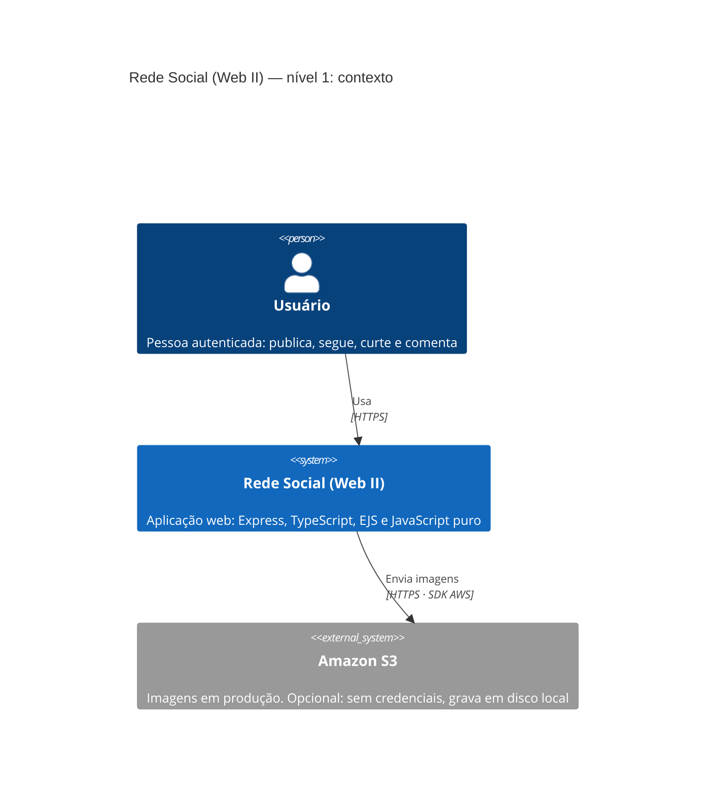
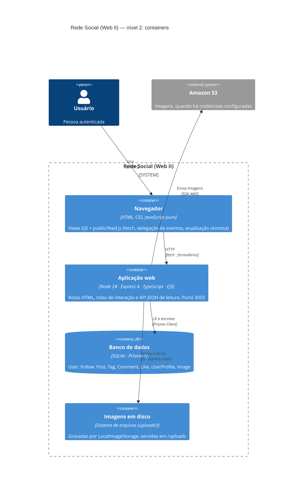
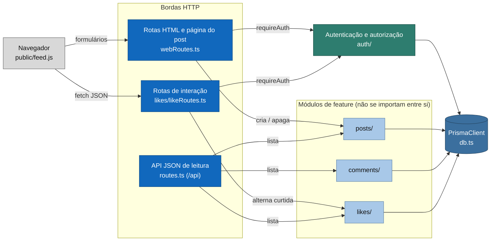
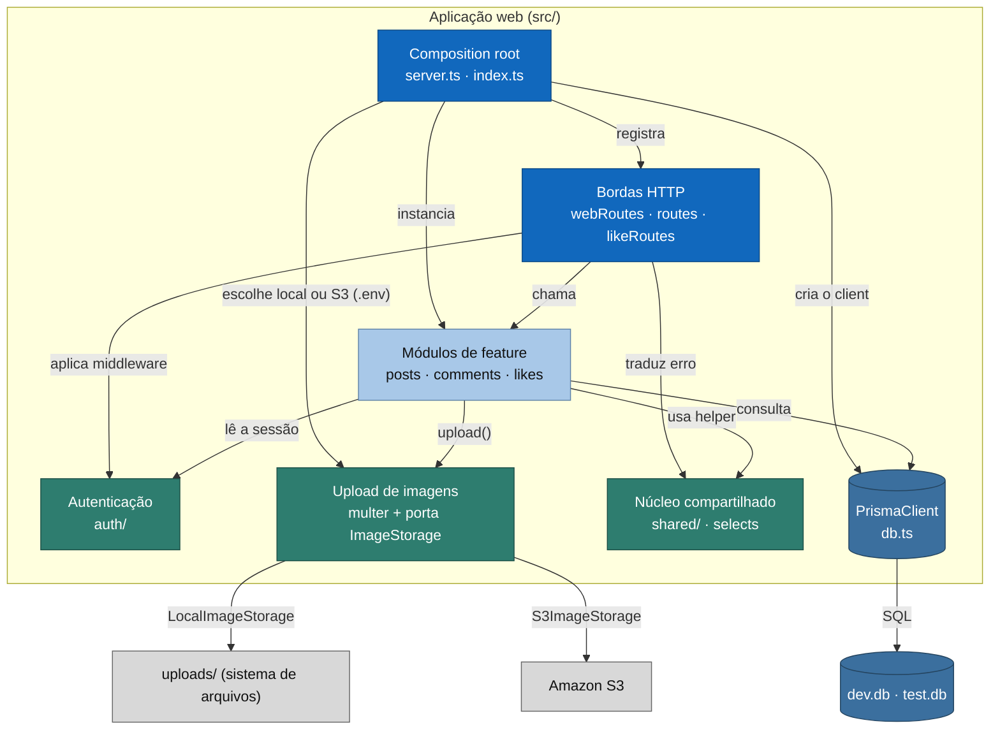

# Diagramas C4 — Rede Social (Web II)

Modelo [C4](https://c4model.com) de Simon Brown: níveis que respondem a perguntas diferentes.
Os diagramas são **Mermaid** — renderizam no GitHub, no GitLab e no preview do VS Code, e ficam
versionados junto do código, sem imagem exportada para envelhecer em paralelo.

| Nível | Pergunta que responde | Quando muda |
| --- | --- | --- |
| 1 — Contexto | Quem usa e de quais sistemas externos a aplicação depende? | Nova integração externa (S3, SMTP, gateway) |
| 2 — Containers | O que roda e onde? Onde ficam os dados e os arquivos? | Novo processo, novo banco, novo armazenamento |
| 3a — Componentes: caminho da requisição | Como uma requisição do navegador chega ao banco? | Nova rota, novo módulo de feature |
| 3b — Componentes: composição e infraestrutura | Quem instancia o quê, e o que atravessa todos os módulos? | Novo adaptador, nova dependência externa, mudança no composition root |

**Regra de manutenção:** mudou um módulo ou uma dependência externa, o diagrama muda **no mesmo
commit** da mudança. Ver `docs/README.md`.

### Duas escolhas de notação, e por quê

1. **O nível 3 aparece em dois recortes.** Um diagrama único com 13 componentes e 20 arestas não é
   lido: ou o leitor ignora as setas, ou ignora o diagrama. Separar "caminho da requisição" de
   "composição e infraestrutura" mantém cada um no tamanho em que o desenho ainda informa.
2. **Níveis 1 e 2 usam a notação C4 nativa do Mermaid; o nível 3 usa `flowchart`.** O renderizador
   C4 do Mermaid posiciona tudo automaticamente e, acima de ~6 componentes, os rótulos das arestas
   caem em cima das caixas e as setas se cruzam — verificado renderizando os dois desenhos lado a
   lado. O `flowchart` mantém a semântica do C4 (fronteira da aplicação, agrupamento por camada,
   externos em cinza, banco em cilindro) com o layout sob controle. Notação a serviço da leitura.

---

## Nível 1 — Contexto

Quem está de fora do sistema. O usuário é uma pessoa autenticada; o S3 é o único sistema externo, e
ele é opcional.

---

## Nível 2 — Containers

O que roda separadamente. A aplicação é **um** processo Node: não há front-end SPA, não há fila, não
há cache externo. O banco é um arquivo SQLite acessado em processo pelo Prisma.

---

## Nível 3a — Componentes: caminho da requisição

Do navegador até o banco. A leitura importante é a direção das setas: as **bordas HTTP** conhecem os
módulos de feature; os módulos **não se conhecem entre si** (ADR-0001); e todos falam com o banco por
um único ponto.

### Fronteiras de módulo (o que o diagrama está afirmando)

| De → para | Pode? | Por quê |
| --- | --- | --- |
| borda (`webRoutes`, `routes`, `likeRoutes`) → módulo de feature | **sim** | é o trabalho da borda traduzir HTTP em chamada de Controller |
| módulo → módulo (ex.: `likes/` importar `posts/`) | **não** | ADR-0001: colaboração pelo `PrismaClient`, não por import de Controller |
| módulo → `shared/` | **sim** | erros, paginação e helpers HTTP são núcleo comum, sem estado |
| módulo → `uploads/` (porta) | **sim** | `ImageStorage` é porta; quem chama não sabe se é disco ou S3 |
| qualquer módulo → `@prisma/client` | **sim, hoje** | decisão consciente do Trabalho II; a porta de persistência é tema do Trabalho III |

### O que este diagrama ainda **não** tem

Itens do Trabalho II ainda não implementados — o diagrama mostra o estado atual, não o alvo:

- `comments/` não tem caminho de escrita (`create`, `remove`) nem rota (`POST /posts/:id/comments`);
- `likes/` só cobre curtida de post (não há `toggleCommentLike` nem `/comments/:id/like`);
- não existe componente de carrossel nem de feed paginado/scroll infinito;
- `Post.imageUrl` ainda é coluna `String?`, não relação `Post → PostImage[]`.

Cada um desses entra aqui **no commit que o implementar**.

---

## Nível 3b — Componentes: composição e infraestrutura

Quem instancia o quê (`server.ts` / `index.ts`) e o que **atravessa** todos os módulos sem ser módulo
de feature: autenticação, upload e o núcleo compartilhado.

### Como ler

- **azul-escuro** = borda de entrada (traduz HTTP, não tem regra de negócio);
- **azul-claro** = módulo de feature (tem a regra, recebe o `PrismaClient`);
- **verde** = peça transversal (autenticação, upload, núcleo compartilhado) — atravessa os módulos;
- **cilindro** = dado persistido (banco);
- **cinza** = fora da aplicação (navegador, disco, S3).
